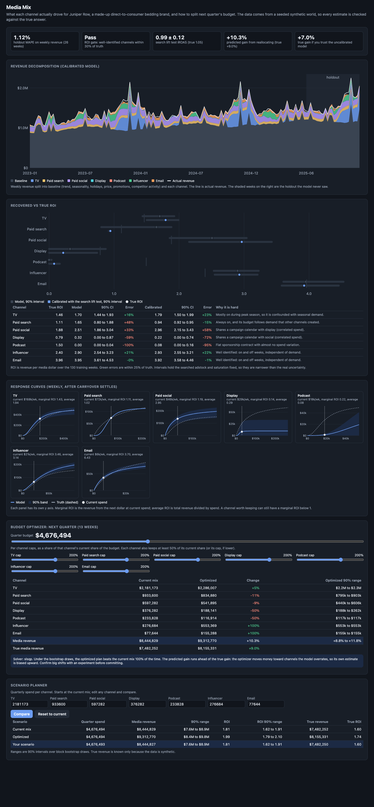

# Media Mix

Marketing mix modeling (MMM) for Juniper Row, a made-up direct-to-consumer bedding brand that spends across 7 channels. The question is the one every marketing team asks: what did each channel actually drive, and how should next quarter's budget be split? Three years of weekly data come from a seeded synthetic world where the true answer is known, so every estimate is checked against it. The model uses adstock and Hill saturation transforms, a ridge regression with non-negative media coefficients, block bootstrap intervals, and a lift-test calibration prior. A budget optimizer and scenario planner sit on top. A FastAPI service serves it all with a plain HTML dashboard.



## Results

The model is fit on 130 weeks and tested on the last 26. **Holdout MAPE on weekly revenue: 1.12%** (calibrated model; 1.10% without calibration). ROI is revenue per media dollar over the training weeks. Intervals are 90% block bootstrap intervals.

| Channel | True ROI | Model | 90% CI | Error | Calibrated | 90% CI | Error | Why it is hard |
|---|---:|---:|---|---:|---:|---|---:|---|
| TV | 1.46 | 1.70 | 1.44 to 1.93 | +16% | 1.79 | 1.50 to 1.99 | +23% | Mostly on in peak season |
| Paid search | 1.11 | 1.65 | 0.80 to 1.88 | +48% | **0.94** | 0.92 to 0.95 | **-15%** | Always on, budget follows demand |
| Paid social | 1.88 | 2.51 | 1.86 to 3.04 | +33% | 2.96 | 2.15 to 3.43 | +58% | Correlated with display |
| Display | 0.79 | 0.32 | 0.00 to 0.87 | -59% | 0.22 | 0.00 to 0.74 | -72% | Correlated with social |
| Podcast | 1.50 | 0.00 | 0.00 to 0.04 | -100% | 0.08 | 0.00 to 0.16 | -95% | Almost no spend variation |
| Influencer | 2.40 | 2.90 | 2.54 to 3.23 | +21% | 2.93 | 2.55 to 3.21 | +22% | Well identified |
| Email | 3.96 | 3.95 | 3.61 to 4.53 | 0% | 3.92 | 3.58 to 4.46 | -1% | Well identified |

The **lift test** is a simulated geo experiment: paid search goes dark for 6 weeks in 40 of 80 regions. It reads an iROAS of 0.99 (90% CI 0.87 to 1.11; true 1.05). Adding it as a prior pulls paid search from +48% to -15%.

**Budget plan for next quarter**, same total as last quarter ($4.68M). Each channel can move between 50% and 200% of its current share. The optimizer uses the calibrated model:

| Channel | Current | Optimized | Change | Optimized 90% range |
|---|---:|---:|---:|---|
| TV | $2,181,173 | $2,286,007 | +5% | $2.2M to $2.3M |
| Paid search | $933,600 | $834,880 | -11% | $795k to $903k |
| Paid social | $597,282 | $541,895 | -9% | $440k to $606k |
| Display | $376,282 | $188,141 | -50% | $188k to $262k |
| Podcast | $233,828 | $116,914 | -50% | $117k to $117k |
| Influencer | $276,684 | $553,369 | +100% | $553k to $553k |
| Email | $77,644 | $155,288 | +100% | $155k to $155k |
| **Media revenue** | $8.44M | $9.31M | **+10.3%** predicted (90% range +8.8% to +11.8%) | true **+9.0%** |

The plan from the uncalibrated model predicts +9.8% but gets +7.0% in truth, because it trusts the overstated search ROI. Calibrating one channel with an experiment was worth 2 points of real revenue growth. The optimized plan beats the current mix in 100% of bootstrap draws. The full numbers are in [reports/summary.md](reports/summary.md) and [reports/eval.json](reports/eval.json).

**What the model gets wrong, and why.**
- **Podcast** is a flat contract ($18k a week, 2% variation). With nothing to learn from, its effect looks like the intercept, and the ridge penalty pushes it to zero. Its interval sits at zero too, so the bootstrap does not reveal the problem. Only an experiment or a planned change in spend can.
- **Display and paid social** share a campaign calendar (spend correlation 0.54). The model gets their combined ROI roughly right (1.73 vs 1.39) but gives most of the credit to social.
- **TV** runs mostly in October to December, the same weeks as a peak season bump in demand that the model's seasonality terms cannot fully capture. TV absorbs some of that bump and is overstated by 16 to 23%.
- **Paid search** is always on and its budget follows demand, including demand that TV, social, and influencer created and unobserved demand shocks. The model credits search for that demand (+48%) until the lift test corrects it.
- **Email and influencer** are well identified: they have weeks on and weeks off that do not follow demand. That contrast near zero spend is what pins down average ROI.

## Why

MMM is how marketing teams allocate budgets when user-level tracking is not available or not trusted. It is also easy to get confidently wrong: the regression will always return a number per channel, and an optimizer will happily move money based on it. This repo shows the whole loop (transforms, constrained regression, intervals, optimization) and, because the world is synthetic, shows exactly where the method fails and how much one experiment helps.

## Architecture

```
 world (seeded)                     model                                  validation and planning          serving
 ┌────────────────────────────┐    ┌───────────────────────────────┐    ┌────────────────────────────┐    ┌──────────────────────┐
 │ 156 weeks, 7 channels      │    │ adstock (geometric, Weibull)  │    │ recovered vs true ROI      │    │ FastAPI              │
 │ baseline, price, promo,    │    │ then Hill saturation          │    │ holdout MAPE               │    │ /api/fit             │
 │ competitor, demand shocks  │───▶│ coordinate descent search on  │───▶│ geo lift test -> prior     │───▶│ /api/decomposition   │
 │ true adstock, Hill, ROI    │    │ 4 rolling validation windows  │    │ response curves, mROI      │    │ /api/curves          │
 │ 4 designed challenges      │    │ ridge, media coef >= 0        │    │ optimizer (SLSQP, greedy)  │    │ /api/optimize        │
 └────────────────────────────┘    │ block bootstrap (8 weeks)     │    │ scenarios over draws       │    │ /api/scenarios       │
                                   └───────────────────────────────┘    └────────────────────────────┘    │ /healthz, /metrics   │
                                                                                                          └──────────────────────┘
```

| Piece | File |
|---|---|
| Synthetic world, true parameters, challenges | [src/mediamix/world.py](src/mediamix/world.py) |
| Adstock and Hill transforms | [src/mediamix/transforms.py](src/mediamix/transforms.py) |
| Constrained ridge with priors | [src/mediamix/ridge.py](src/mediamix/ridge.py) |
| Design matrix, fit, decomposition, ROI, response curves | [src/mediamix/model.py](src/mediamix/model.py) |
| Hyperparameter search | [src/mediamix/search.py](src/mediamix/search.py) |
| Block bootstrap | [src/mediamix/bootstrap.py](src/mediamix/bootstrap.py) |
| Geo lift test and calibration prior | [src/mediamix/calibration.py](src/mediamix/calibration.py) |
| Budget optimizer | [src/mediamix/optimizer.py](src/mediamix/optimizer.py) |
| End to end study, gate | [src/mediamix/study.py](src/mediamix/study.py) |
| API, JSON logs, Prometheus metrics, UI | [src/mediamix/app.py](src/mediamix/app.py), [logs.py](src/mediamix/logs.py), [metrics.py](src/mediamix/metrics.py), [static/index.html](src/mediamix/static/index.html) |

**Transforms.** Geometric adstock carries a share of each week's spend into the next (`a[t] = x[t] + decay * a[t-1]`). Weibull adstock spreads it over 13 weeks with a shape that can peak late, which suits TV. Hill saturation `z^s / (z^s + K^s)` works on adstocked spend divided by the channel's typical weekly spend, so K = 1 means "half saturated at a normal week".

**Model.** Weekly revenue = intercept + controls (trend, two yearly sine and cosine pairs, Black Friday and Christmas, price, promo, competitor) + sum of `beta_c * hill(adstock(spend_c))`. Coefficients come from one bounded least squares solve with ridge rows stacked under the data and lower bounds of 0 on the media coefficients.

**Search.** Each channel has 14 adstock options and 24 Hill options. A full grid over 7 channels is impossible, so the search runs coordinate descent: one channel at a time, alternating adstock and Hill, scored by error on 4 rolling 13-week validation windows, 2 passes, then the ridge penalty. That is about 2,100 small solves and takes 3 seconds. On a clean two-channel world the search recovers the exact true parameters (a test checks this). On the full world it overfits the validation windows somewhat, which is the main reason ROI errors are larger than the intervals suggest. The results in this README use seed 3, which was picked during tuning. On seeds 1 to 8 the search often overfit more and the recovered ROIs were further from truth, so treat these numbers as a good case rather than a typical one.

**Calibration.** The geo test's iROAS is linear in the channel's coefficient once the transforms are fixed, so the experiment becomes a Normal prior on that coefficient. That prior is one extra penalty row with weight `sigma / se`, which is exactly the posterior mode under that prior. The hyperparameter search then reruns with the prior in place.

**Optimizer.** Maximize the sum of steady-state response curves subject to the total budget and per-channel min and max. SLSQP runs from 3 starts, because Hill curves with shape > 1 are S-shaped and the problem is not concave. A greedy marginal ROI allocator also runs and is the fallback if scipy is missing; a test shows it stalls on S-curves. Uncertainty comes from re-optimizing under 100 bootstrap draws.

**Bayesian version.** Skipped. The calibrated ridge is already the posterior mode of a Gaussian model with a Normal prior on one coefficient. A sampler (PyMC or NumPyro) would add hyperparameter uncertainty, but it is a heavy dependency for a laptop demo.

## How to run

```bash
cd media-mix
uv sync --python 3.12
make eval          # full study (about 10 s), writes reports/
make run           # API and UI on http://127.0.0.1:8859 (fits at startup, about 10 s)
```

```bash
curl localhost:8859/healthz
curl localhost:8859/api/fit                          # ROI table, lift test, fit stats, default plan, gate
curl localhost:8859/api/decomposition?model=base     # weekly baseline and channel contributions
curl localhost:8859/api/curves                       # response curves, bands, marginal ROI
curl -X POST localhost:8859/api/optimize -H 'content-type: application/json' \
  -d '{"quarter_budget": 4000000, "bounds": {"tv": {"min": 0, "max": 1500000}}}'
curl -X POST localhost:8859/api/scenarios -H 'content-type: application/json' -d '{"user": {"tv": 1000000}}'
curl localhost:8859/metrics
```

Set `MEDIAMIX_BOOT` to change the number of bootstrap draws (default 200) and `MEDIAMIX_SEED` for a different world. `make gate` exits 1 unless influencer, email, and social plus display combined are within 30% of true ROI. CI runs it on every push.

Docker is not installed on the development machine, so the `Dockerfile` (multi-stage, non-root, HEALTHCHECK) is built and smoke tested in GitHub Actions only. Everything runs without it through `uv`.

## Tests

90 tests, about 15 seconds: `make test`.

- Transforms: geometric and Weibull adstock against hand-computed values, Hill at six hand-worked points, the Hill derivative against finite differences, steady state multipliers, channel scale.
- Ridge: equals least squares with no penalty, equals the closed form with a penalty, non-negativity holds, the intercept is not shrunk, priors pull toward their mean and a strong prior pins the coefficient.
- World: seeding, true ROI equals the configured ROI, sales = baseline + media + noise, and each designed challenge is present (correlation, peak season share, flat podcast, search following demand).
- Search: on a clean world it recovers the exact true adstock and Hill for both channels and coefficients within 5%; folds are ordered and disjoint; the score never gets worse.
- Bootstrap: block length and contiguity, reproducibility, draws vary but keep hyperparameters, hard channels have wider intervals than well-identified ones.
- Model: decomposition sums to fitted revenue, ROI is contribution over spend, response curves start at zero and rise, marginal ROI matches finite differences, holdout MAPE under 3%.
- Optimizer: budget and bounds respected, beats an equal split, identical curves split equally, marginal ROIs equalize at the optimum, greedy fallback without scipy, infeasible bounds rejected.
- Calibration: lift test estimate within 3 standard errors of truth, a strong prior reproduces the experiment, calibration moves search toward truth, and the calibrated plan does better in truth.
- Study, CLI, and API end to end: gate, ROI table, plans, scenarios, curves, decomposition, validation errors (422), request ids, and metrics.

## MMM limitations, and when to run an experiment instead

- **It is correlational.** MMM finds channels whose spend moves with revenue. If spend follows demand (search, retargeting, anything budgeted as a share of sales), the model credits the channel for demand it did not create. Here that overstated search by 48%.
- **No variation, no answer.** A channel that never changes (a flat sponsorship, an always-on brand line) cannot be measured. The model will still print a number, and its interval can look tight.
- **Correlated channels get split arbitrarily.** If two channels always move together, the model can measure the pair but not each one. Plan them as a pair or stagger their flights on purpose.
- **Average ROI needs weeks near zero spend.** Without them, the shape of the curve near zero is a guess, and so is average ROI. Marginal ROI at current spend is better identified, and it is what budget decisions need.
- **Intervals are too narrow.** Bootstrap intervals here hold the searched hyperparameters fixed. Real uncertainty is larger, as the misses above show.
- **Optimizers amplify errors.** They move money toward whichever channels the model overrates, so the predicted gain is biased upward (here +10.3% predicted vs +9.0% true; without calibration +9.8% vs +7.0%).

Run an experiment (geo holdout, go-dark test, or a platform lift study) when a channel is always on, flat, correlated with another, or about to get a large budget change. Then feed the result back as a prior, as this repo does. Use MMM for the overall picture and for channels that already vary on their own.

## Production notes

- **Data.** Weekly spend by channel from ad platforms and finance, revenue from the order system, and controls (price, promotions, competitor indices, macro) from a warehouse. Two to three years of weekly data is the usual minimum; regional data multiplies the sample.
- **Hyperparameters.** Replace coordinate descent with a Bayesian model (PyMC-Marketing, Meridian, or similar) so adstock and saturation uncertainty flow into the intervals, and add priors from past experiments for every channel that has one.
- **Experiment program.** Keep a calendar of geo tests on the channels the model is least sure about, and refit with each new result. The model's interval widths say where the next test should go.
- **Refresh and monitoring.** Refit monthly, track holdout MAPE and coefficient drift, and alert when a channel's ROI moves outside its last interval.
- **Planning.** Flighted channels (TV) need a weekly plan, not a steady-state average; the optimizer would work over weekly spend paths with flighting constraints.

## License

MIT. See [LICENSE](LICENSE).
